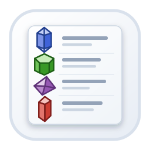
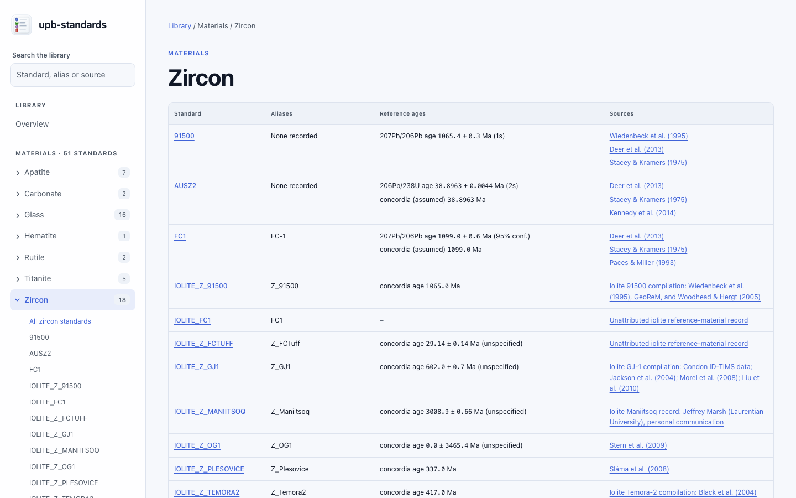

<p align="center"></p>

# upb-standards

Reference-material values for LA-ICP-MS U–Pb and trace-element reduction in
UPbRPy. This format-2 TOML library records source quantities, uncertainties,
measurement conventions and citations for zircon, apatite, titanite, rutile,
glass, carbonate and hematite. UPbRPy derives missing reciprocal and linked
ratios from these documented inputs.

[Browse the materials, sources and conventions](https://duserzym.github.io/upb-standards/).



## What is in it

This table is generated from `library.toml` and the material files. Imported
records keep their own names and may share aliases with other standards.

<!-- materials:start -->
| Mineral | Standards | Count |
| --- | --- | ---: |
| apatite | AFB1, BR5, IOLITE_A_DURANGO, IOLITE_A_MAD, MADUCSB, IOLITE_A_MCCLURE, OL2 | 7 |
| carbonate | IOLITE_C_MMC, IOLITE_WC_1 | 2 |
| glass | BCR, BIR, GSD, GSE, IOLITE_G_BCR2G, IOLITE_G_BHVO2G, IOLITE_G_GSD1G, IOLITE_NIST_16, IOLITE_G_NIST610, IOLITE_G_NIST611, IOLITE_G_NIST612, IOLITE_G_NIST614, IOLITE_NIST_614_NEW, IOLITE_G_NIST616, NIST610, NIST612 | 16 |
| hematite | IOLITE_H_HFO | 1 |
| rutile | KNW, R632 | 2 |
| titanite | BLR, ElMuerto, KHAN, MKED, OLT | 5 |
| zircon | 91500, AUSZ2, FC1, IOLITE_Z_91500, IOLITE_FC1, IOLITE_Z_FCTUFF, IOLITE_Z_GJ1, IOLITE_Z_MANIITSOQ, IOLITE_Z_OG1, IOLITE_Z_PLESOVICE, IOLITE_Z_TEMORA2, LTSE, OG1, PL, R33, S513, Seiland, Temora | 18 |
<!-- materials:end -->

Regenerate the table with `python3 site/build.py --readme`.

## How UPbRPy uses it

UPbRPy bundles a copy of the library. To load another checkout, pass its
directory or `library.toml` to `UPbRPy.load_standard_measurements(path)`.
In Studio, choose **File → Reference Material Library** and select
`library.toml` to adopt a reviewed library explicitly. The older wide CSV
remains a separate compatibility archive.

Keep a clone at `~/UPbRPy/upb-standards` for the desktop apps, or set
`UPB_STANDARDS_DIR` before launching an app to use another clone. Git must
be on the app’s path. In Updates, **Check standards** fetches Git metadata,
compares the clone’s TOML files with GitHub main and lists differences. It
also checks whether the active library digest differs from the clone. If
GitHub is unavailable, it uses the last checked revision when available,
otherwise local HEAD. Checking does not adopt or edit values.

Record the Git revision and library digest when archiving a reduction.
[Usage and provenance details](https://duserzym.github.io/upb-standards/upbrpy.html).

## Conventions

Keep isotope systems, initial Pb, radiogenic ratios, total ratios and
uncertainty conventions distinct. Missing uncertainties are not zero.
Each measurement records its role, unit, status and source.
[Read the conventions and derivation rules](https://duserzym.github.io/upb-standards/conventions.html).

[The 2026-11 audit lists what was checked and what is not yet verified.](https://github.com/duserzym/upb-standards/blob/main/docs/audit-2026-11.md)

## How to cite

Cite this library as **upb-standards**,
<https://github.com/duserzym/upb-standards>, with the Git revision used.
Always also cite the original publications listed for each value in the
[source registry](https://duserzym.github.io/upb-standards/sources.html).
Keep the full library digest with the archived reduction.

## Contributing a material

Add documented source quantities in a material TOML file, register it in
`library.toml`, and link each measurement to a full citation in
`sources.toml`. Include the source locator, uncertainty convention and
status. Run UPbRPy’s library checks and regenerate the manual and this
table. [Instructions and a complete example](https://duserzym.github.io/upb-standards/contributing.html).

Build and check the manual locally with Python 3.11 or later:

```sh
python3 site/build.py --out _site --check
```

Open `_site/index.html` directly; no server is needed. Regenerate the icon
PNGs with `sh assets/make_icons.sh` (requires `rsvg-convert`). The Pages
workflow runs by hand with `gh workflow run pages`.

## License

[MIT](LICENSE).
